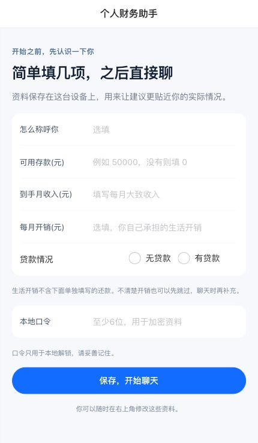
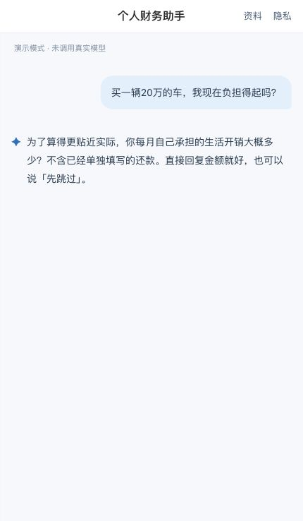
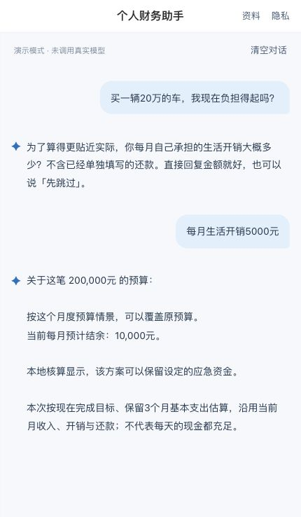

<div align="center">

# Personal Finance Agent

**隐私优先的个人理财规划 Agent**

用自己的存款、收入、生活开销和还款做规划。通过聊天设定储蓄目标、安排应急资金、评估收入变化，并比较不同方案。**精确财务数据加密保存在浏览器，测算也在本地完成。云端 AI 经授权使用脱敏对话、财务区间和工具结果摘要。**

[为什么重视隐私](#为什么重视隐私) · [能帮你做什么](#能帮你做什么) · [界面预览](#界面预览) · [快速开始](#快速开始) · [Agent 如何工作](#agent-如何工作)

</div>

## 为什么重视隐私

个人理财需要结合真实收支。Personal Finance Agent 让浏览器用精确金额算出结余、应急金和目标缺口，让 AI 根据目标、还款压力和现金缓冲解释该怎么调整。比如，AI 可以看到「还款占收入的比例区间」和「存款能覆盖几个月基本开销」，浏览器则用你的实际余额和月供核算，再把具体金额显示给你。

画像和对话记录加密保存在当前浏览器。你可以在隐私页撤销发送授权、锁定资料或导出加密备份。自由文本的自动脱敏可能遗漏敏感表达，具体的数据流见[隐私设计](#隐私设计)。

## 能帮你做什么

当前版本从个人理财规划的基础做起，用月度收支判断目标能否实现、日常开销和还款能否维持，以及遇到变化时有哪些调整空间。

| 规划场景 | 可以怎么问 | 能得到什么 |
| --- | --- | --- |
| 储蓄目标 | 一年后想有10万元储蓄，按现在的收支够吗？ | 结合当前存款和预计月结余，估算到期可用资金与目标缺口。 |
| 应急资金 | 如果要留6个月的基本开销，这个目标还可行吗？ | 把应急金纳入当前目标，重新核算预算余量。 |
| 收入变化 | 如果接下来6个月没有收入，现有存款还能撑住吗？ | 测算收入中断对现金缓冲的影响，评估调整生活开销的情景。 |
| 大额支出 | 现在买20万元的车和一年后再买，预算差多少？ | 在聊天中调整金额或期限，比较资金缺口与购买后的缓冲。 |

资料不足时，助手会在对话中继续询问。例如，生活开销可以在初始化时先留空，等需要测算时再补充。计算进度、补问和结果都显示在聊天里。

后续规划方向包括按风险偏好区分稳健与进取情景，以及按用途划分应急金、短期目标和长期资金。

## 界面预览

以购车预算为例，下面展示一次规划如何从初始化走到对话补问和计算结果。截图来自实际页面，使用虚构资料与 **Mock 演示模式**。

<table>
  <tr>
    <th>① 简单初始化</th>
    <th>② 在聊天中补充信息</th>
    <th>③ 直接看到预算结果</th>
  </tr>
  <tr>
    <td valign="top"></td>
    <td valign="top"></td>
    <td valign="top"></td>
  </tr>
</table>

演示资料：存款30万元、月收入1.5万元、无贷款；聊天中补充每月生活开销5000元。金额仅用于展示流程。

## 使用方式

1. **建立基础资料**：填写可用存款、到手月收入、贷款情况；称呼和生活开销可选填。
2. **设置本地口令**：资料加密保存在当前浏览器，保存后直接进入聊天。
3. **提出一个实际问题**：例如购车预算、储蓄目标或收入中断。首次发送前确认脱敏信息授权。
4. **根据补问继续聊**：补充缺少的信息，或者调整金额、期限与应急金假设，查看重新核算的结果。

右上角「资料」可以修改画像，「隐私」可以查看服务模式、撤销出站授权、锁定本地金库及导出或恢复加密备份。

界面采用移动端优先的 H5 布局；在桌面浏览器中以最大430px宽度居中显示，无需安装桌面客户端。

## 快速开始

需要 **Node.js 24+** 和 **pnpm 10.32.1**。

```bash
git clone https://github.com/JJymUp/personal-finance-agent.git
cd personal-finance-agent
pnpm install --frozen-lockfile

# 使用本地 Mock 模式体验流程，无需 API Key，不调用云端模型
FORCE_MOCK=true pnpm dev
```

打开 [http://127.0.0.1:5173](http://127.0.0.1:5173)。开发服务同时启动前端（5173）和 Node.js API（3000）。

Mock 模式通过预设规则模拟对话与工具调度，适合体验流程、开发和测试；它不具备真实大模型的语言理解能力。

### 接入真实模型

项目支持提供工具调用能力的 OpenAI 兼容 Chat Completions 服务。先从 [.env.example](.env.example) 创建本地配置；已有 `.env.local` 时直接编辑，不要覆盖原配置。

```bash
cp .env.example .env.local
```

在 `.env.local` 中设置：

```dotenv
FORCE_MOCK=false
OPENAI_API_KEY=你的服务端密钥
OPENAI_BASE_URL=https://api.openai.com/v1
OPENAI_MODEL=服务商支持的模型名称
```

然后使用 `pnpm dev` 启动或重启服务。API Key 只由 Node.js 服务端读取，不使用 `VITE_` 前缀，不打包到浏览器。模型调用会消耗所配置服务商的额度。

不同兼容服务对工具调用和参数格式的支持可能不同，接入后请先使用合成资料验证。当前为开源原型，Mock 测试通过不等同于所有真实模型或公网部署均已验收。

## 隐私设计

项目采用 **浏览器保存和计算精确数据，模型接收经授权的脱敏上下文** 的分工。

| 数据 | 如何处理 |
| --- | --- |
| 存款、工资、还款等画像精确金额 | 留在浏览器，用于本地计算；不作为原始画像上传。 |
| 聊天原文与金额映射 | 加密保存在本地。发送前识别并替换金额、已知称呼、账号及部分联系方式。 |
| 模型收到的上下文 | 经授权的脱敏聊天、财务区间与比例摘要、受限工具参数和结果摘要。 |
| 对话中的金额引用 | 例如把“20万元”替换为 `[金额:amount_1]`；原始数值由浏览器保管，模型不能通过该标识直接读取。 |
| 存储与备份 | Web Crypto PBKDF2 + AES-GCM 加密，密文存入 IndexedDB；支持加密备份导出和恢复。 |
| 授权 | 按用途检查出站权限；可以在隐私页撤销后续发送。已发送的数据不能通过本地撤销从服务商处自动删除。 |

**本地保存不等于完全匿名。** 脱敏文字与财务摘要仍可能透露个人情况，自动识别也不能覆盖所有敏感表达。请勿在聊天里粘贴密码、密钥、身份证号或完整账户资料。

本地加密用于保护保存的资料；页面解锁时仍需在内存中处理明文。清除浏览器数据、更换设备或丢失口令都可能导致资料无法恢复，请妥善保存加密备份。

## Agent 如何工作

一次预算问题会经过以下过程：

1. **理解目标**：浏览器先处理聊天中的敏感信息，模型结合脱敏上下文判断是普通回答、继续追问，还是开始预算测算。
2. **选择工具**：进入测算后，Agent 可以请求浏览器评估候选方案或补充缺失信息。
3. **本地执行**：浏览器使用真实画像执行确定性计算，只返回受控的结果摘要；精确金额不跟随工具结果上传。
4. **继续推演**：模型根据工具结果选择下一步；条件不满足时，可以比较其他候选方案。
5. **核验并回答**：浏览器核验结果引用的证据及资料版本，将本地数值与解释组合成聊天回复。

模型负责理解和解释，代码负责金额计算、权限检查、输入校验与证据核验。HTTP + SSE 连接服务端的 Agent 流程和浏览器工具执行。

### 预算结果的口径

聊天采用月度预算情景：现在购买按当前可用存款测算，N个月后按当前收入、生活开销及还款保持不变的N个月结余估算。默认保留3个月基本支出作为可调整的假设。

储蓄目标按目标时点的资金情况核算，包含当前可用存款，不等同于“从今天起新增存下同样金额”。结果不代表每天的现金都充足，也不会自动计入未提供的税费、车辆后续使用成本或投资收益。

## 技术栈与工程结构

| 部分 | 技术与职责 |
| --- | --- |
| H5 前端 | Vue 3、TypeScript、Vite、Vant、Pinia |
| 本地数据 | Web Crypto、IndexedDB / Dexie、本地计算器与隐私网关 |
| Node.js 服务端 | Fastify、HTTP + SSE、Agent 会话状态机、模型 Provider |
| 共享协议 | Zod Schema、工具请求与结果校验、授权范围与版本绑定 |
| 验证 | Vitest 单元与集成测试、Playwright H5 E2E、合成样本评测 |

```text
apps/web/            H5 页面、聊天交互、本地工具、加密金库
apps/server/         对话入口、Agent 调度、SSE、模型适配
packages/contracts/  前后端共享协议与校验规则
scripts/             开发启动、CLI 与合成样本评测
e2e/                 浏览器端到端测试
assets/readme/       可公开的合成演示截图
```

### 开发与验证

```bash
pnpm typecheck
pnpm lint
pnpm build

# 单元与集成测试
FORCE_MOCK=true pnpm test

# 合成样本评测
pnpm eval:mock

# H5 端到端测试；配置强制使用 Mock
pnpm exec playwright install chromium
pnpm test:e2e

# 命令行演示
pnpm cli -- --provider mock --non-interactive
```

## 常见问题

**为什么打开后没有初始化页面？**

初始化只面向尚无有效本地画像的用户。已有画像时，解锁后会直接进入聊天；可通过右上角「资料」查看和修改。站点按浏览器来源隔离存储，`localhost` 与 `127.0.0.1`、不同端口的资料不互通。

**一定要把所有生活情况填完才能开始吗？**

不需要。先填写基础信息，生活开销可留空，在测算需要时通过聊天补充。不同问题需要的信息不同，资料不足时结果可能只是初步估算。

**它会帮我买基金、选股票或操作账户吗？**

不会。当前用于个人预算讨论和现金流情景测算，不接入交易账户，不执行金融交易。输出仅供参考，不构成专业投资建议。

## 参与贡献

欢迎通过 [Issues](https://github.com/JJymUp/personal-finance-agent/issues) 反馈问题、讨论功能，或提交 Pull Request。反馈时请附上复现步骤、运行模式及必要的错误信息，使用合成数据替代真实财务资料。

仓库只公开源码、配置模板、合成测试与演示图片。`.env.local`、个人数据、备份、运行日志和内部 `docs/` 均不应提交；新增样例或截图也请使用虚构资料。

## License

[MIT](LICENSE)
